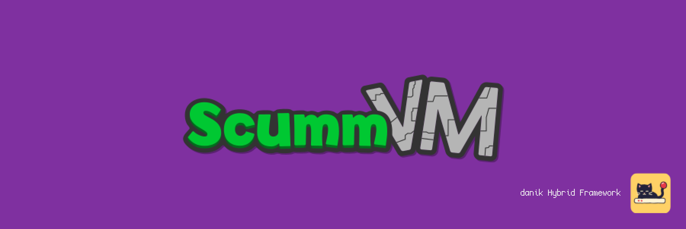
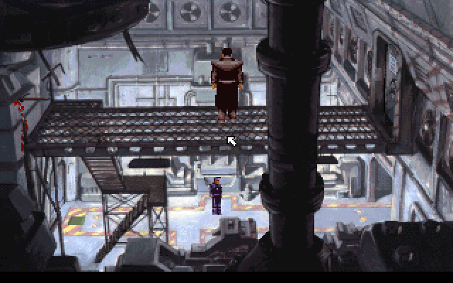

# ScummVM for MiSTer

ScummVM on [MiSTer FPGA](https://github.com/MiSTer-devel/Main_MiSTer/wiki) as a hybrid port.

The game is [ScummVM](https://www.scummvm.org), which plays the classic point-and-click adventures of LucasArts, Sierra, Revolution and many others from their original data files. It runs on the MiSTer's ARM CPU. The ScummVM FPGA core provides native 15kHz video (CRT, VGA and HDMI) at each game's own resolution (320x200 for most, 640x400 and 640x480 interlaced), 44.1kHz audio with the music on the core's MIDI synthesizer or FM chip, and keyboard, mouse and gamepad input. The two halves talk through shared DDR3 memory.

> **Beta.** Expect rough edges and please report problems in the issues.
>
> **Disclaimer:** AI is being extensively used to speed up development, but the project is well-maintained and supported.

  
  

## Requirements

- **danik_hybrid_ports**, the launcher: run it **once** from the MiSTer's `Scripts` menu ([The launcher](#the-launcher)). Without it the core says "Game not running".
- **Game data**, which is not included: your own copies of the games ScummVM plays, from their disks or CDs or as sold by GOG or Steam, their demos, or the freeware games on [scummvm.org](https://www.scummvm.org/games/). Every 2D engine of ScummVM is built in (see its [compatibility list](https://www.scummvm.org/compatibility/)), and Grim Fandango with ScummVM's software renderer, which is experimental and plays it more slowly than a PC. Not built in are the 3D games and those with much full-motion video or pictures bigger than 640x480, among them Escape from Monkey Island, Blade Runner, Broken Sword 2.5, Myst III, Riven, Zork Nemesis, Zork: Grand Inquisitor, The Longest Journey, Syberia, Starship Titanic, Thimbleweed Park and the Wintermute and Nancy Drew games.
- **Recommended:** a mouse and a keyboard, which the game was designed for. A gamepad works as well.

## Installation

With `update_all` (Downloader 2.4 or newer, which update_all keeps up to date):

1. Copy [`downloader_danik_hybrid_ports.ini`](https://raw.githubusercontent.com/ItsDanik/Hybrid_MiSTer/main/launcher/downloader_danik_hybrid_ports.ini) to the root of your SD card (`/media/fat`).
2. Run `update_all`. That installs the launcher, **danik_hybrid_ports**, in `Scripts`.
3. Run **danik_hybrid_ports** from the `Scripts` menu, tick the games you want and press *X: Apply*. They are installed, and update_all keeps them up to date.
4. Copy **everything** in each of your games' folders, all the files and folders as they are, into a folder of its own in `/media/fat/games/dnk/ScummVM/`, e.g. `games/dnk/ScummVM/Monkey Island 2/`. Which files each game is known by: ScummVM's [data files](https://wiki.scummvm.org/index.php/Datafiles) page.
5. Load the game from the `Other` menu, e.g. **dnk-ScummVM**, or from the `Hybrid Ports` folder if you moved the games there in the launcher.

> [!NOTE]
> The game data can go on a USB drive instead, into the same folder there (`/media/usb0/games/dnk/ScummVM/`): the game looks for it there first, and then keeps its settings and saved games there as well. Everything else stays on the SD card.

> [!IMPORTANT]
> **HDMI or VGA:** if you play on HDMI or on a VGA monitor rather than a 15kHz CRT, open the OSD and set *HDMI Only* to **Yes**. ScummVM's launcher set to 640x480 (the OSD's *Launcher*) and the games of 640x400 or 640x480 are drawn at those resolutions, which are interlaced for a CRT and show combing on any other screen without it.

The menu entry starts ScummVM's launcher, where your games are once you have added them: *Add Game...* adds the game in a folder you pick, *Mass Add...* (the arrow beside *Add Game...*) every game in a folder and in the folders in it, so picking `games/dnk/ScummVM/` itself, where the browser starts, adds them all. That list, ScummVM's settings and those of each game are in `games/dnk/ScummVM/scummvm.ini`, saved games in `games/dnk/ScummVM/saves/` (on the USB drive, if the game data is there). The game's log is in `/media/fat/logs/dnk/ScummVM/scummvm.log`.

## The launcher

**danik_hybrid_ports** is what turns a menu entry into a running game. Once you've run it from the `Scripts` menu, it starts with the MiSTer, watches which core is loaded, and starts the game whenever a hybrid port's menu entry is loaded. It serves all our hybrid ports at once and updates itself through `update_all`.

Run it from the `Scripts` menu again whenever you want to change something. Its screen has:

- **Launcher**: on or off. Off, the ports' games no longer start (the core says "Game not running"), until you turn it on again.
- **Menu entries**: where the games appear in the MiSTer menu:
  - **Other, as dnk-\<Title\>**: each game in the `Other` menu, e.g. **dnk-Doom** (the default).
  - **Other/Hybrid Ports**: all of them in a *Hybrid Ports* folder in `Other`, without the `dnk-` in front.
  - **Main menu/Hybrid Ports**: a *Hybrid Ports* folder of its own in the main menu, next to `Arcade`, `Console` and `Other`.

  Moving them keeps each game's settings and button mappings. Favourites, recent lists and Zaparoo tags that point at the old place have to be made again.
- **The ports and their games**, a tickbox each. Tick what you want, untick what you don't.

*X: Apply* installs what is ticked and removes what is not, through Downloader, and moves the menu entries if you chose another place. When a port is removed, your game data, saved games and settings stay, and ticking it again brings it back as it was.

## OSD options

| Option | |
|---|---|
| Aspect ratio, Scale, Scandoubler Fx, Stereo Mix | as in other cores |
| FPS Counter | shows the pictures per second in the top left corner |
| HDMI Only | **Yes** if no CRT is connected: resolutions of 640x400 and more are then progressive instead of interlaced, and so is the core's own screen before the game, which moves at 60 pictures a second for a CRT and shows fine lines on HDMI without it, as does ScummVM's launcher at 640x480. The analog output is switched off while one is shown, so that a 15kHz screen can never get such a signal. Nothing changes at lower resolutions. Not needed with `forced_scandoubler=1` (VGA monitor); not there with `direct_video=1` |
| CRT Options | **Horizontal Size**: the picture's width **Horizontal Pos**: moves it left or right **Vertical Pos**: moves it up or down **Flicker Filter**: Light (default), Strong or Off: softens fine lines that blink while the picture is interlaced  For a 15kHz screen: fits the picture to it. HDMI is not affected but by the Flicker Filter; not there with `forced_scandoubler=1` |
| Sound Volume | sound effects, 100% (default) to 0%, in steps of 10% |
| Music Volume | music, 100% (default) to 0%, in steps of 10% |
| Speech Volume | voices, 100% (default) to 0%, in steps of 10% |
| Subtitles | **Game Default**: as set in each game's options (default) **Speech Only**: voices, no text **Subtitles Only**: text, no voices **Both**: voices and text |
| Text Speed | **Normal**: as set in each game's options (default) **Slowest**, **Slow**, **Fast**, **Fastest**: how long a line of text stays on the screen |
| Music | **MIDI**: General MIDI on the core's synthesizer, or on an MT32-pi when one is on (default) **FM chip**: on the FM chip, as an AdLib card  Applies when the next game starts: a game picks its music once. Music made for the Roland MT-32 alone is turned into General MIDI. Music for two FM chips (OPL3, Dual OPL2) is played on one worked out on the ARM |
| SoundFont | **Default**: GeneralUser GS, which comes with the port **1 to 7**: your own `.sf2` files in `games/dnk/SoundFonts/`, in the order of their names, or as the MIDI Player core sets them  A SoundFont that is missing, damaged or too big (over 64 MB of samples) is said in the MiSTer's info box, and the music goes to the FM chip |
| MT32-pi | **On**: the music is played on the MT32-pi (default) **Off**: as without it **MT32-pi Synth**: SoundFont (default) or MT-32 (it needs the MT-32 ROMs on the Pi's card): games with music for the Roland MT-32 then play that **MT32-pi ROM**: MT-32 v1, MT-32 v2 or CM-32L **MT32-pi SoundFont**: Pi's own (default) or one of the first eight on its card, 0 to 7 **Reset Hanging Notes**: the Pi stops all its notes, the music goes on  Only there while an [MT32-pi](https://github.com/dwhinham/mt32-pi) answers on the MiSTer's user port. *On* and *Off* apply at once, the switch between General MIDI and MT-32 music when the next game starts |
| Pointer Speed | how fast the stick and the d-pad move the pointer: Normal (default), Slow or Fast |
| Stick Deadzone | **Normal** (default) **Small**: the pointer moves at the stick's slightest push **Large**: for a stick that drifts |
| Launcher | **320x200**: ScummVM's launcher as a list, in the resolution of most games (default) **640x480**: interlaced at 15kHz, with the selected game's picture and details beside the list, or the games' pictures in a grid  Applies at once while the launcher is on the screen, otherwise when you return to it |
| Cheats | **Fast Mode (SCUMM)**: Off (default), Fast or Turbo: LucasArts' games run as fast as they can, walking and cutscenes too. Greyed out while a game of another engine runs |
| Reset | starts ScummVM again from its beginning, as the USER button does |
| Save Diagnostic Report | the last line: see [If something is wrong](#if-something-is-wrong) |

The volumes, subtitles, text speed and music are the OSD's, over each game's own settings; ScummVM's options have the rest.

## Controls

- **Keyboard and mouse:**

| Key | Action |
|---|---|
| Mouse | the pointer; its buttons click as in the game |
| Esc | skip a cutscene |
| . (full stop) | skip a line of dialogue |
| F5 | the game's own menu (save, load, quit), in the games that have one |
| Space | pause |
| Ctrl+F5 | ScummVM's menu: save, load, options, return to the launcher |
| Ctrl+Q | quit ScummVM, back to the MiSTer menu |
| Typing | the parser games (Sierra's early ones, text adventures) are played by typing commands: they are best with a keyboard |

- **Gamepad** (default mapping):

| Button | Action |
|---|---|
| Left stick | moves the pointer: slowly when pushed a little, fast when pushed fully |
| D-pad | moves the pointer: a tap moves it two pixels; held, it starts slow and gets faster (a game with actions of its own on the d-pad keeps them) |
| A (Xbox B / PlayStation Circle) | Left Click |
| B (Xbox A / PlayStation Cross) | Right Click |
| X (Xbox Y / PlayStation Triangle) | Skip: skips a cutscene (Esc) |
| Y (Xbox X / PlayStation Square) | Skip Line: skips a line of dialogue |
| L (LB / L1) | Slow Pointer: while held, the pointer moves slowly, and a tap of the d-pad moves it one pixel |
| R (RB / R1) | Game Menu: the game's own menu (F5), in the games that have one |
| Select | Keyboard: ScummVM's keyboard on the screen, to type with the pointer |
| Start | Main Menu: ScummVM's menu (save, load, options, return to the launcher) |
| In the menus | in ScummVM's launcher and menus *Menu OK* confirms and *Menu Back* closes a menu; if those are on buttons that also have an action above, there they are only *Menu OK* (a click at the pointer) and *Menu Back* (on a PlayStation or Xbox pad without a mapping: Cross or A clicks, Circle or B closes). In a game the buttons do their actions above, and *Menu OK* clicks and *Menu Back* is Esc only on buttons without one |

Change the buttons in the OSD under *Define ScummVM buttons*. *Menu OK* and *Menu Back* there are only needed for a spare button without a game function. While the OSD is open, the game gets no input.

> [!WARNING]
> A button left without a name in *Define ScummVM buttons* does not reach the game at all, except L2/R2, L3/R3 and *Menu OK* / *Menu Back*. Name every button there, or leave the definition as it is. To go back to the default buttons, delete `config/inputs/ScummVM_input_*_v3.map` on the SD card.

Naming a saved game without a keyboard: Select brings up the keyboard on the screen, the pointer types on it. In ScummVM's own save menu a saved game left without a name is named after the date and time.

## If something is wrong

If the game stutters, the sound breaks up or something else is wrong, open the OSD while it happens and pick **Save Diagnostic Report**, the last line of the menu. The game keeps running; MiSTer's info box says the report is saved in `games/dnk/diagnostics/` on the SD card. Send that file (`ScummVM_<date>_<time>.zip`) with a few words on what went wrong.

The report has the setup (versions, the video and audio lines of `MiSTer.ini`, the OSD settings), how the last 60 seconds went, the game's log and a screenshot. Nothing else: no network settings, addresses, saved games or lists of your files.

## Building

How the port works, how to build it and notes for development: [NOTES.md](NOTES.md).

## Support

If you enjoy this project, you can support my work on [Patreon](https://www.patreon.com/itsdanik).

## Credits

- **[ScummVM](https://www.scummvm.org)** by the ScummVM Team and its contributors.
- **[scummvm-icons](https://github.com/scummvm/scummvm-icons)** by its authors: the games' pictures in the launcher.
- **[Cozette](https://github.com/the-moonwitch/Cozette)** by Samhain and contributors: the font of the port's ScummVM theme.
- **[GeneralUser GS](https://www.schristiancollins.com/generaluser.php)** by S. Christian Collins: the SoundFont of the core's MIDI synthesizer, which comes with the port, its licence next to it.
- **[JTOPL](https://github.com/jotego/jtopl)** by Jose Tejada (jotego): the FM chip in the core.
- **[SDL](https://libsdl.org)** by Sam Lantinga and contributors.
- **[MiSTer](https://github.com/MiSTer-devel)** by Sorgelig and the MiSTer-devel contributors: the framework and Template_MiSTer.
- **[MiSTer Frontier](https://github.com/MiSTerOrganize/MiSTer_Frontier)** by MiSTer Organize: thank you for the inspiration. Hybrid cores on the MiSTer, and the way their game is launched (a daemon that watches the loaded core and runs a script from its games folder), were inspired by MiSTer Frontier.

This project and its maintainers are in no way associated with or endorsed by the ScummVM Team or the companies whose games ScummVM plays. It does not include any game data.

## License

The top-level scripts, tools and documentation are licensed under the [GPL-3.0](LICENSE). The components keep their own licenses: the part of the shared framework the game is linked with (`hybrid/hps/`) is GPL-2.0-or-later, the rest of `hybrid/` GPL-3.0 except where its files say otherwise, ScummVM (`scummvm/`) is GPL-3.0-or-later, some of its parts under the licences in `scummvm/LICENSES/`, the game icons are GPL-2.0, the Cozette font MIT, SDL and the SDL drivers in `hybrid/sdl2` are zlib, the FPGA core and the MiSTer framework are GPL-2.0 (`core/LICENSE`, with the core's own sources GPL-2.0-or-later).
